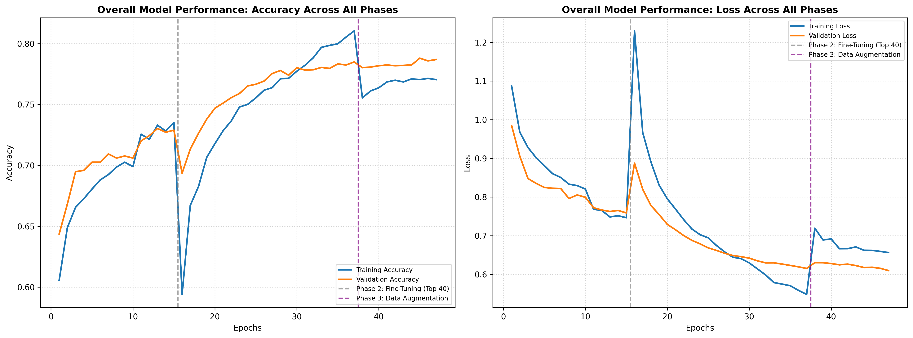
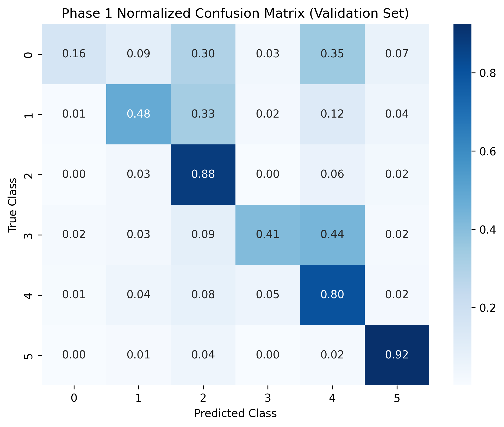
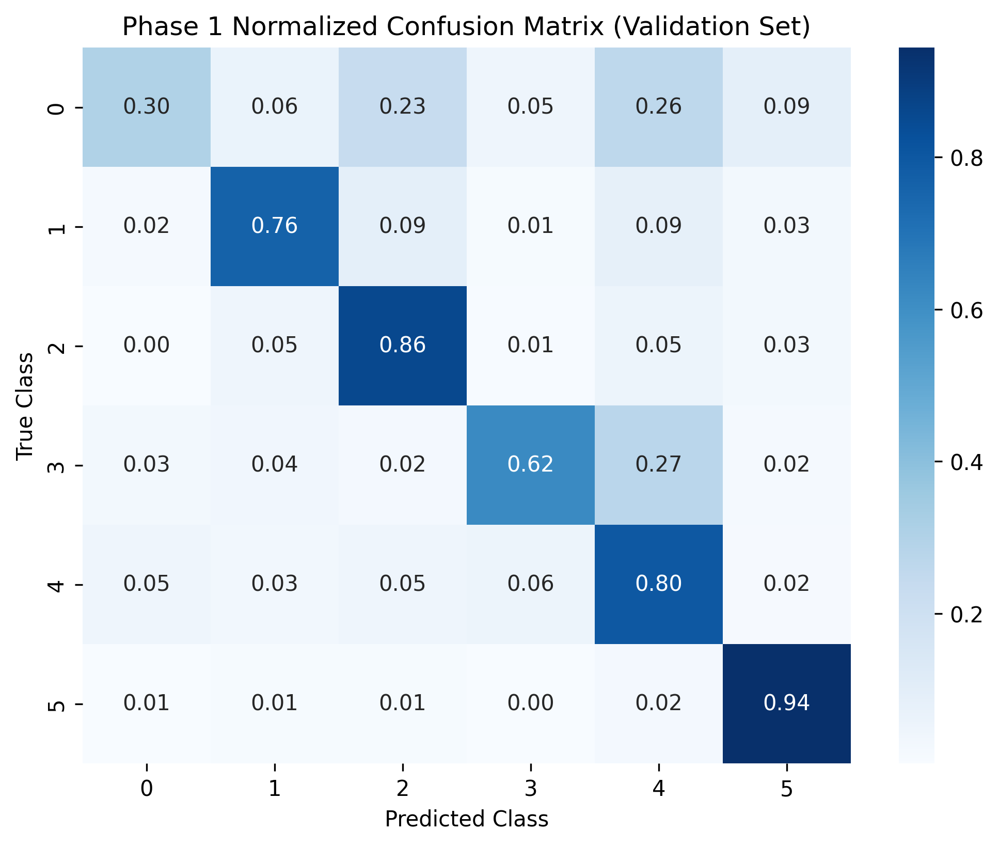

# Galaxy Morphology Classification Using Deep Learning
### A Six-Class Experiment with Galaxy10 DECaLS

## 1. Overview

Galaxy morphology provides important information about the structural properties and evolutionary characteristics of galaxies. Automated morphological classification offers a way to analyse large astronomical image datasets efficiently.

This project explores deep learning for galaxy morphology classification using the Galaxy10 DECaLS dataset.

The initial approach involved classifying galaxies into ten morphological categories. Following feedback on the classification strategy, a second experiment was conducted to investigate whether consolidating closely related morphological categories into broader groups could produce more effective classification.

The revised experiment introduced a six-class taxonomy and employed transfer learning with EfficientNetB0, followed by progressive fine-tuning and data augmentation.

## 2. Dataset and Morphological Classification

**Dataset:** Galaxy10 DECaLS  
**Total images:** 17,736  
**Original categories:** 10  
**Revised categories:** 6

The original categories were consolidated based on similarities in their observed morphological characteristics.

### Revised Classification Scheme

| Class | Original Galaxy10 Categories | Images |
|---|---|---:|
| Disturbed | Disturbed Galaxies | 1,081 |
| Merging | Merging Galaxies | 1,853 |
| Elliptical | Round Smooth, In-between Round Smooth, Cigar-shaped Smooth | 5,006 |
| Barred Spiral | Barred Spiral | 2,043 |
| Unbarred Spiral | Tight Spiral, Loose Spiral | 4,457 |
| Edge-on | Edge-on without Bulge, Edge-on with Bulge | 3,296 |
| **Total** | | **17,736** |

The dataset was divided into training and validation subsets using an 80:20 stratified split, with a random state of 42.

## 3. Methodology

### Model Architecture

EfficientNetB0, pretrained on ImageNet, was used as the convolutional feature extraction backbone.

The classification head consisted of:

- Global Average Pooling
- Dense layer with 256 neurons and ReLU activation
- Dropout layer with a rate of 0.4
- Six-unit Softmax output layer

The architecture retained the same feature extraction backbone while adapting the final classification layer to the revised taxonomy.

### Training Strategy

Training was organised into three progressive phases.

**Phase 1 — Feature Extraction (Epochs 1–15)**

- Froze the pretrained EfficientNetB0 backbone.
- Trained the newly introduced classification head.

**Phase 2 — Fine-tuning (Epochs 16–37)**

- Unfroze the top 40 layers of the backbone.
- Fine-tuned the pretrained features using a lower learning rate.
- Conducted two consecutive training runs.

**Phase 3 — Fine-tuning with Data Augmentation (Epochs 38–47)**

- Introduced data augmentation during fine-tuning.
- Continued training to investigate its effect on validation performance.

The complete experiment consisted of 47 training epochs across the three phases.

## 4. Experimental Results

### Validation Performance

The following results represent the final validation metrics recorded at each training stage.

| Training Stage | Validation Accuracy | Validation Loss |
|---|---:|---:|
| Phase 1 | 72.89% | 0.7588 |
| Phase 2 — Run 1 | 77.54% | 0.6544 |
| Phase 2 — Run 2 | 78.49% | 0.6152 |
| Phase 3 — Augmented | **78.69%** | **0.6096** |

The progression shows an improvement in validation performance during feature fine-tuning. The final augmented phase achieved the highest final validation accuracy and lowest validation loss.

The improvement between the second fine-tuning run and the augmented phase was modest.

### Training Performance

The following figure presents the overall training and validation accuracy and loss trajectories across all 47 epochs.



### Classification Performance

Confusion matrices were generated at the end of each training stage to examine class-wise prediction behaviour.

**Phase 1**



**Phase 2 — Run 1**


**Phase 2 — Run 2**


**Phase 3**



## 5. Model Interpretability

Grad-CAM (Gradient-weighted Class Activation Mapping) was used to investigate the image regions contributing to the model's classification predictions.

This provides a qualitative means of examining whether the network focuses on visually relevant galaxy structures when making predictions.

## 6. Final Model

The Phase 3 checkpoint was selected as the final model based on its validation performance.

| Parameter | Details |
|---|---|
| Architecture | EfficientNetB0 |
| Pretrained weights | ImageNet |
| Classification classes | 6 |
| Training epochs | 47 |
| Validation accuracy | 78.69% |
| Validation loss | 0.6096 |
| Model checkpoint | `galaxy10_efficientnetb0_phase3.keras` |

The trained model is stored in the `model-2/` directory.

## 7. Limitations and Further Exploration

This experiment focuses on morphological classification from image data. Several considerations remain relevant:

- The six-class taxonomy simplifies some distinctions present in the original dataset.
- Validation accuracy alone does not establish generalisation to independent astronomical datasets.
- The modest improvement during the augmentation phase should not be interpreted as statistically significant without further evaluation.
- Morphological appearance alone cannot capture all the physical properties of a galaxy.

Further exploration could investigate additional astronomical information, including spectroscopic features, to complement image-based morphology classification.

## 8. Repository Structure

```text
Galaxy-Morphology/
│
├── comparison_visual/
├── galaxy_classifier_app/
├── model/
├── model-2/
├── notebook/
├── visuals/
├── visuals2/
│   ├── cm_phase1.png
│   ├── cm_phase2_run1.png
│   ├── cm_phase2_run2.png
│   ├── cm_phase3.png
│   ├── master_training_performance.png
│   ├── phase1_performance.png
│   ├── phase2_run1_performance.png
│   ├── phase2_run2_performance.png
│   └── phase3_augmented_performance.png
│
├── .gitignore
└── README.md
```

## 9. Conclusion

This project investigates the application of transfer learning and deep learning to astronomical image classification.

By restructuring the original ten morphological categories into six broader classes, the experiment explored an alternative classification strategy and evaluated its performance through progressive fine-tuning.

The final model achieved 78.69% validation accuracy. The experiment also incorporated confusion-matrix analysis and Grad-CAM to examine classification behaviour and model interpretability.

Overall, this work represents an application of computational methods to observational astronomy, combining astronomical image data, neural network modelling and quantitative evaluation.
